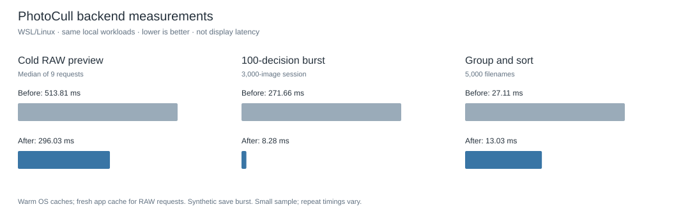

# Performance audit

The changes target measured backend costs: preview extraction, repeated natural sorting, and repeated whole-session saves. They do not change RAW rendering quality or culling decisions.



| Workload | Before | After | Method |
| --- | ---: | ---: | --- |
| Cold RAW preview | 513.81 ms | 296.03 ms | Median of 9 requests: three Sony ARWs × three fresh app caches |
| 100 decisions in a 3,000-image session | 271.66 ms | 8.28 ms | One synthetic burst, awaited until durable |
| Session writes for that burst | 100 | 1 | Every caller still awaits a snapshot containing its decision |
| Group/sort 5,000 filenames | 27.11 ms | 13.03 ms | Median of three runs |
| Scan 3,000 generated entries | 158.66 ms | 145.41 ms | One run; mostly filesystem work |

These are observations on a WSL/Linux test host, not Mac timings or a Photo Mechanic comparison. The OS cache was warm, so “cold” means a new PhotoCull cache, not a cold SD card. Three files and a few runs do not establish a general speed guarantee. A repeated after run measured 316.91 ms median RAW preview, 6.51 ms for the save burst, and 12.44 ms filename grouping. Browser decode, GPU presentation and end-to-end keyboard latency are excluded.

## Implemented

- Read supported embedded JPEG/TIFF ranges directly after ExifTool locates their offsets. Bounds, size and image headers are validated; unusable ranges fall back to ExifTool extraction. Existing cached inventories remain usable.
- Coalesce decisions queued before a session write starts, avoiding repeated JSON serialization and file writes during bursts. Responses still wait for durable atomic writes; late edits queue another snapshot.
- Reuse one natural-order collator and index session items by ID.

The GUI design pass additionally reuses filmstrip/rating nodes and supplies pane/grid controls; those improvements are validated behaviorally, not included in the backend timings above.

## Reproduce

```sh
npm run perf:audit -- local /path/to/photo-fixtures
```

This creates generated entries and state in a temporary directory and only reads the supplied RAW/JPEG folder. Reports are written under `artifacts/performance/`. The historical before/after JSON files are local, ignored artifacts.

## Remaining costs

The first RAW preview still needs metadata discovery, disk reads and JPEG decoding. Render fallback remains much slower and more memory-intensive than embedded previews, so it retains its single-worker gate and persistent render cache. Warm preview reads were already fast; increasing cache complexity for marginal gains was not justified by these measurements. Real large shoots on slower cards, Mac hardware and end-to-end presentation latency need separate profiling.
